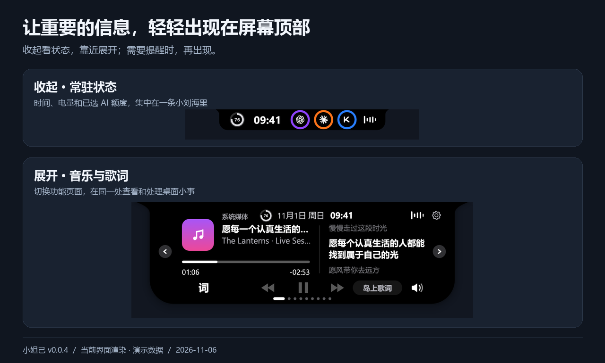
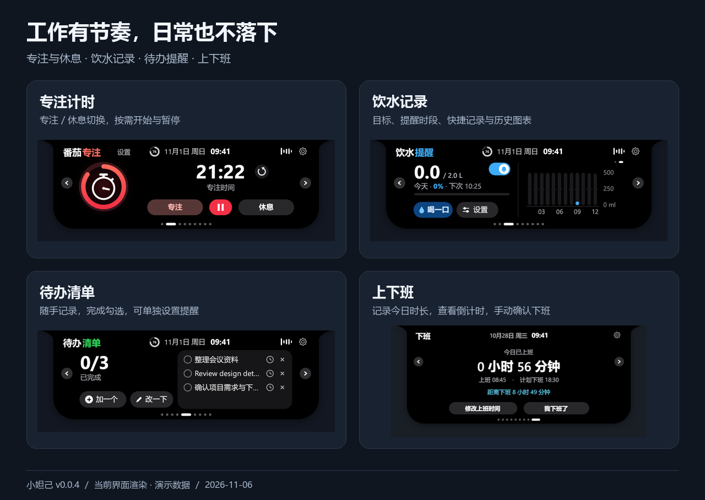
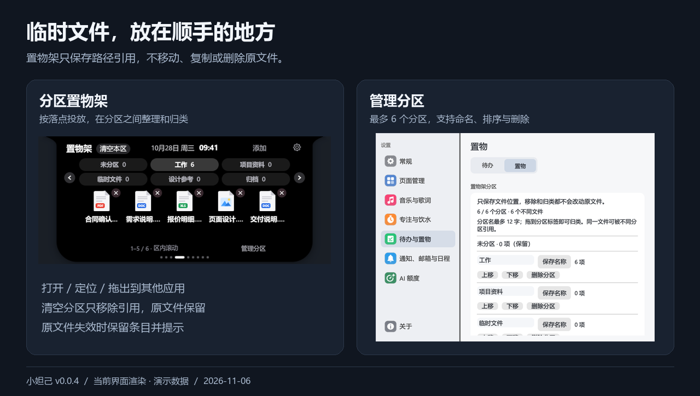
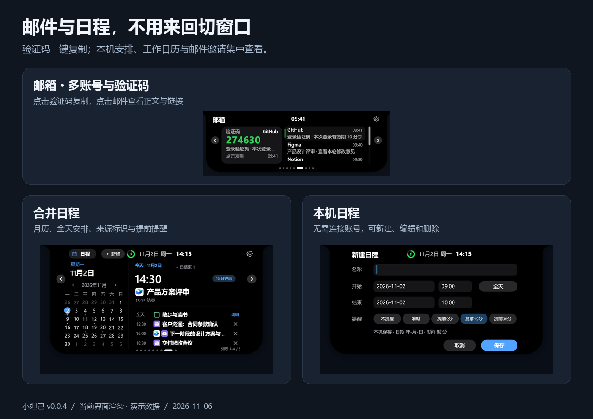

<div align="center">


# 小妲己

**让重要的信息，轻轻出现在屏幕顶部。**

Windows 桌面伙伴 · 音乐与歌词 · 邮件验证码 · 日程提醒 · AI 额度

[](#安装与更新)
[](LICENSE)

[使用指南](docs/USAGE.md) · [历史更新记录](CHANGELOG.md) · [品牌与发布说明](docs/BRANDING.md)

</div>



## 一个小岛，装下桌面上的小事

小妲己贴在屏幕顶部，收起时是一条小刘海。鼠标靠近时展开，离开时收起；需要处理的信息出现时再提醒你。它由 Rust 和 egui 构建，不依赖 Electron。

| 功能 | 可以做什么 |
| --- | --- |
| 桌面伙伴 | 会眨眼、打盹、喝水，也会拿起麦克风跟着音乐唱；可切换极简模式 |
| 音乐与歌词 | 读取 Windows 媒体会话及网易云本机播放信息；可选择来源，按支持能力控制播放、切歌和进度，支持岛上单行歌词 |
| 专注与饮水 | 专注／休息计时、饮水目标、提醒时段、快捷记录与撤销 |
| 上下班 | 当天首次启动记录上班、手动修正、下班倒计时、到点提醒与延后、确认下班和本地历史 |
| 文件置物架 | 最多 6 个可命名分区，按落点拖入、区内浏览和跨区归类；打开、定位及拖出文件，移除不删除原文件 |
| 待办 | 添加、编辑、完成任务；用日期和时间选择器设置可选提醒 |
| 邮件 | 多账号收信、验证码来源识别与点击复制、正文阅读、默认浏览器打开链接 |
| 日程 | 月历和当日安排；合并工作日历与邮件邀请，支持全天、跨天、重复日程及单次修改／取消 |
| AI 额度 | Codex、Claude、Kimi、Grok Bot、Gemini；多账号、常驻圆环、重置时间和自选配色 |
| 系统提示 | 电源、电量、网络、音量、大写锁定、输入语言和蓝牙设备状态 |

### 专注工作，也记得休息和喝水

开始一段专注时间，在专注与休息之间切换；饮水面板记录当天进度，可以设置目标和提醒时段。



### 待办随手记，文件临时放

把待办加到屏幕顶部，完成后勾选；需要提醒的事项可以单独设置日期和时间。置物架则用来临时收集文件，支持打开、定位原文件和拖出到其他应用。



### AI 额度，抬眼就能看见

收起时用圆环显示额度，展开后查看账号与重置时间。支持多账号，可选择常驻展示的服务和配色。

各服务与订阅的连接方式及可用性见下方「连接哪些服务」。

### 邮件和日程，放在同一条时间线上



- 正式日历邀请自动进入日程；普通邮件正文出现日期不会自动创建日程。
- 可忽略某条邮件日程，停止显示和提醒；邮件保留，可从详情恢复。
- 滚轮只滚动下方列表；大卡片保持当前选择，点击其他日程才切换详情。
- 同一场日程使用 UID 与开始时间去重，工作日历和邮件来源可以同时标识。

以上为基于演示界面制作的 AI 产品展示图，展示收起、展开与提醒状态，界面细节以实际版本为准。[查看原始界面截图](docs/images)。

## 安装与更新

1. 使用本项目生成的安装版 `小妲己-安装包-v0.0.3-x64.exe`，发布包见[本仓库 Releases](https://github.com/Oliver-Lee-1027/XiaoDaJi/releases)，请勿从上游下载旧品牌版本。
2. 双击安装器，可修改安装位置、选择是否创建桌面快捷方式和开机自启，再点击「一键安装」。桌面快捷方式默认勾选，首次安装默认不开机自启；无需解压。
3. 安装完成后打开「小妲己」，也可从桌面快捷方式启动。在托盘菜单打开设置，选择需要的功能。

需要免安装使用时，下载 `小妲己-v0.0.3-windows-x64.zip` 并完整解压，运行其中的 `小妲己.exe`。程序仍默认使用当前用户的应用数据目录。

本仓库发布的 v0.0.3 安装版与便携版已配置 `Oliver-Lee-1027/XiaoDaJi` 为更新源，可在「设置 → 关于」主动检查后续正式版本。未配置更新源的 v0.0.1 / v0.0.2 用户需先从托盘退出程序，再用新版安装包保留原安装位置覆盖升级一次；原设置和记录会保留。源码构建仍需在编译前显式设置 `XIAODAJI_RELEASE_REPOSITORY=Oliver-Lee-1027/XiaoDaJi`，不会默认访问上游仓库。卸载可通过 Windows「已安装的应用」或安装目录中的 `卸载小妲己.exe` 完成；卸载同样保留用户数据。详细操作见 [使用指南](docs/USAGE.md) 和 [发布步骤](docs/RELEASE.md)。

**系统要求：** Windows 10／11 x64，支持 OpenGL 的显卡驱动。Windows 11 已进行本机实测；Windows 10、不同显卡及多显示器组合的兼容性仍需更多反馈。暂不提供 macOS、Linux 或 ARM64 成品包。

**校验下载：** Release 附带 `SHA256SUMS.txt`，可用 `Get-FileHash -Algorithm SHA256` 比对。当前程序未做商业代码签名，Windows 可能提示未知发布者；请核对仓库与文件校验值后再决定运行。

## 连接哪些服务

| 类型 | 当前入口 | 说明 |
| --- | --- | --- |
| 邮箱 | QQ、163、126、腾讯企业邮、iCloud、Gmail | IMAP；使用服务商要求的授权码或 App 专用密码 |
| 工作日历 | 飞书、钉钉、企业微信 | CalDAV；需要平台提供的独立日历账号／密码，安装桌面端本身不等于授权 |
| AI 额度 | Codex、Claude、Kimi、Grok Bot、Gemini | 各服务的本机登录引用或独立连接方式；不同账号与订阅的可用性可能不同 |

QQ 收信、邮件日程和飞书个人日历已进行真实账号测试；钉钉、企业微信已验证接入代码与界面，但尚未在本轮完成真实账号同步验收。不要把图标或模拟日程预览视为实连保证。

## 数据留在什么地方

- 设置、待办、饮水记录、置物路径和连接元数据保存在 `%APPDATA%\Daozai`。
- 邮箱和日历密码保存在 Windows 凭据管理器；Gemini 会话使用 Windows DPAPI 加密。
- 读取已有 AI 客户端登录时不回写原客户端配置；不要把授权码、Cookie 或登录 JSON 上传到 Issue。
- 邮箱读取收件箱，不读取垃圾邮件文件夹；邮件正文在当前进程中用于展示和识别。
- 开启对应功能后会访问服务商接口和歌词服务，不等于完全离线软件。

完整说明见 [隐私与安全](docs/PRIVACY.md)。

## 从源码构建

需要 Rust stable、MSVC C++ 构建工具和 Windows SDK。开发时建议使用较新的 stable Rust。

```powershell
rustup default stable-x86_64-pc-windows-msvc
$env:XIAODAJI_RELEASE_REPOSITORY = "Oliver-Lee-1027/XiaoDaJi"
cargo build --locked --release --bin daozai
.\target\release\daozai.exe
```

运行测试及打包：

```powershell
cargo test --locked --all-targets --features record -- --test-threads=1
powershell -NoProfile -ExecutionPolicy Bypass -File .\scripts\package.ps1
```

测试按单线程运行，以隔离使用进程环境变量的数据目录测试。低内存设备可设置 `$env:CARGO_BUILD_JOBS = "1"`。打包需要 NSIS 3，可通过 `-NsisCompiler` 指定 `makensis.exe`。源码构建目标仍为 `daozai.exe`，发布时统一为 `小妲己.exe`。发布脚本会检查程序版本、内嵌狐狸图标和运行库依赖，生成单文件 EXE 安装器、精简免安装 ZIP 和 SHA-256 校验文件。

项目结构、界面预览与贡献方式见 [开发指南](CONTRIBUTING.md)。

## 开源与致谢

本项目基于 [岛仔 Daozai](https://github.com/Renly1994/xiaotang-daozai) 定制，原始代码采用 [MIT License](LICENSE)，保留原有版权与许可声明。Rust 依赖、vendored 代码、第三方图标及品牌标识沿用各自的许可或权利声明；MIT 不授予这些服务的商标使用权，也不代表官方合作或认证。详见 [第三方声明](THIRD_PARTY_NOTICES.txt) 和 [依赖说明](docs/DEPENDENCIES.md)。

感谢 egui／eframe、Rust 社区，以及提供参考与素材的开源项目。

## 参考来源与使用说明

- 参考来源：[岛仔 Daozai / xiaotang-daozai](https://github.com/Renly1994/xiaotang-daozai)。感谢原作者及贡献者的开源分享。
- **本项目不作为商用**，仅用于个人学习、研究与交流，不用于商业销售或商业运营。
- 上述说明为本定制项目的用途声明，不修改或替代上游代码及第三方依赖各自的许可证；原有版权与许可声明予以保留。
