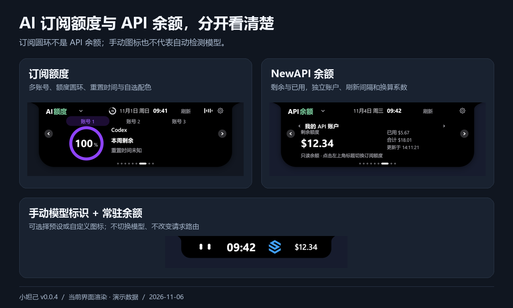
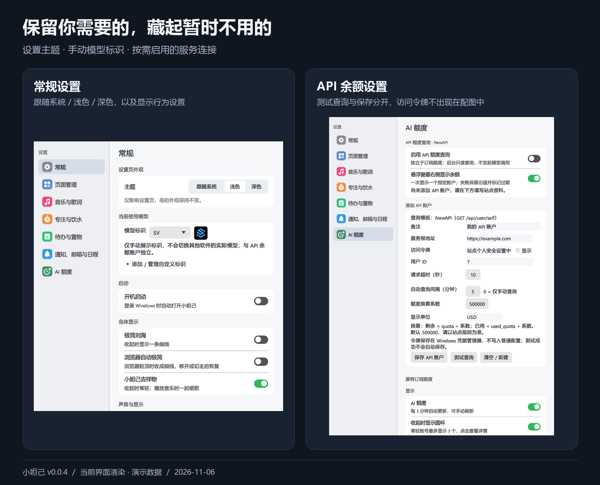

<div align="center">


# 小妲己

**让重要的信息，轻轻出现在屏幕顶部。**

Windows 桌面伙伴 · 音乐与歌词 · 专注与饮水 · 邮件与日程 · AI 额度与 API 余额

[](#安装与更新)
[](LICENSE)

[下载安装](https://github.com/Oliver-Lee-1027/XiaoDaJi/releases) · [使用指南](docs/USAGE.md) · [历史更新记录](CHANGELOG.md) · [品牌与发布说明](docs/BRANDING.md)

</div>


> 本页功能与配图对应 **v0.0.4**。全部产品配图于 **2026-11-06** 由当前代码的真实界面渲染生成，再做裁切与排版，已替换旧 AI 概念图。歌曲、账号、验证码、余额与日程均为隔离测试中的**演示数据**，图中日期也是演示日期，不代表真实账号连接或服务验收。[查看单张界面图与生成方式](docs/images/README.md)。

## 一个小岛，装下桌面上的小事

小妲己贴在屏幕顶部，收起时是一条小刘海，鼠标靠近时展开、离开时收起。日常状态常驻，重要提醒出现时再打扰你；不想看到的页面可以隐藏，常用页面可以调整顺序。

它由 **Rust + egui** 构建，不依赖 Electron。它不是独立音乐播放器、邮件发送客户端，也不是 AI 对话或模型切换工具，而是把已有服务与本机的小工具放在一个轻量入口里。

| 功能 | 可以做什么 |
| --- | --- |
| 桌面伙伴与常驻栏 | 眨眼、打盹、喝水、跟着音乐唱；查看时间、电量和已选额度，调整常驻组件顺序，也可切换极简模式 |
| 音乐与歌词 | 读取 Windows 媒体会话及网易云本机播放信息；选择播放来源，按来源能力控制播放、切歌与进度，支持同步歌词和岛上单行歌词 |
| 专注计时 | 专注／休息切换、开始与暂停、结束提醒，按自己的节奏进入下一阶段 |
| 饮水记录 | 每日目标、单次饮水量、提醒间隔与时段；快捷记录、撤销及历史图表 |
| 上下班 | 当天首次启动记录上班、手动修正、下班倒计时、到点提醒与延后、确认下班和本地历史 |
| 分区置物架 | 最多 6 个可命名分区，按落点拖入、区内浏览与跨区归类；打开、定位和拖出文件，移除引用不删除原文件 |
| 待办与提醒 | 添加、编辑、完成任务，通过日期／时间选择器设置可选提醒 |
| 多账号邮箱 | 收取邮件、识别验证码来源并点击复制；查看正文、独立阅读窗口与默认浏览器打开链接 |
| 本机与工作日程 | 无账号也可新建、编辑、删除本机日程；合并工作日历与邮件邀请，展示月历、全天／跨天安排和提前提醒 |
| AI 订阅额度 | Codex、Claude、Kimi、Grok Bot、Gemini；多账号、常驻圆环、重置时间和自选配色 |
| NewAPI 余额 | 只读查询剩余与已用；多账户、手动／定时刷新、自定义换算系数与单位，可选择一个余额常驻显示 |
| 手动模型标识 | 选择 Codex、Claude、Kimi、Grok、Gemini、SV，或添加自定义图片；只展示标识，不自动检测或切换模型 |
| 系统提示与个性化 | 电源、电量、网络、音量、大写锁定、输入语言及蓝牙设备状态；页面显隐与排序，设置页跟随系统／浅色／深色主题 |

### 专注工作，也记得休息和喝水

开始一段专注时间，按需要切换休息；喝水后点一下记录，记错也能撤销。待办可以只记文字，也可以给某件事单独设提醒。

上下班页面显示今日时长与下班倒计时。当天首次启动自动记录上班，同日重启不重新计时；到点后可延后 10 分钟，或点击「我下班了」结束当天记录。


> 上下班时长按自然经过时间计算，包含午休、锁屏、睡眠和中途退出，不等于实际电脑操作时间，也不是正式考勤。到点提醒需自行开启；软件退出或电脑关机期间无法持续提醒。

### 临时文件，放在顺手的地方

把文件拖到某个分区标签，或拖入当前文件区，即可加入置物架。最多支持 **6 个分区（含固定的「未分区」）**，可命名、排序，也可以把文件重新归类。

- **顺手取用：** 打开文件、定位原文件、拖出到其他应用。
- **不搬动原文件：** 置物架只保存路径引用；移除、清空或删除分区不会删除硬盘上的文件。
- **失效会提示：** 原文件被移动或删除后，条目保留并提示失效。


### 邮件与日程，不用来回切窗口

验证码卡片显示邮件来源与主题，点击即可复制；其他邮件可在岛内查看，或打开独立阅读窗口。正文中的网页链接交给默认浏览器。

- **本机日程：** 不需要连接邮箱或工作账号，可直接新建、编辑、删除，并设置全天或定时安排及提醒；不会上传到工作日历。
- **工作日历：** 只读接入飞书、钉钉和企业微信，查看月历、当天安排及同步状态。
- **邮件邀请：** 正式日历邀请自动进入日程；普通邮件正文里的日期不会自动创建安排。
- **来源与去重：** 同一日程按 UID 与开始时间去重，可以同时显示工作日历与邮件来源。
- **可控提醒：** 可忽略某条邮件日程来停止显示与提醒，邮件仍保留，也可从详情恢复。


### AI 订阅额度与 API 余额，分开看清楚

**订阅额度**用圆环展示，展开后查看账号与重置时间；支持多个账号、自选配色及常驻展示。

**NewAPI 余额**通过兼容的 `/api/user/self` 接口只读查询，不发起模型调用，也不把累计用量冒充周期套餐百分比。

- 可配置多个 API 账户，选择其中一个在小岛右侧常驻显示；点击余额查看详情。
- 支持手动刷新、自动查询间隔、换算系数和单位；「测试查询」与「保存账户」分开操作。
- 尚未查到结果显示 `—`，真实零余额显示 `$0.00`；失败或过期保留旧值并加 `*`，不会伪装成实时成功结果。
- **当前模型图标由你手动选择。** 它只是一枚标识，不检测其他软件正在使用的模型，不改变请求路由，也不自动切换余额账户。



NewAPI 兼容性取决于站点接口及换算规则，不保证支持 Sub2API、Token Plan 或任意第三方余额接口。当前配图使用模拟响应，未据此宣称已完成真实站点令牌联调；连接方式及适用范围见下方「连接哪些服务」。

### 保留你需要的，藏起暂时不用的

在页面管理中调整功能页顺序和显隐；隐藏页面不删除其数据。常驻组件可以调整排列，模型标识与 API 余额保持在右侧。

设置页支持跟随系统、浅色和深色主题，**主题只影响设置窗口，小岛仍保持深色外观**。还可按需设置开机启动、极简刘海、浏览器贴顶时自动极简、全屏隐藏、吉祥物与通知。

<details>
<summary>查看当前常规设置与 API 余额设置</summary>



</details>

## 安装与更新

1. 从[本仓库 Releases](https://github.com/Oliver-Lee-1027/XiaoDaJi/releases) 下载本项目的 **v0.0.4 x64 安装包**，本地打包名为 `小妲己-安装包-v0.0.4-x64.exe`，请勿从上游下载旧品牌版本。
2. 双击安装器，可修改安装位置、选择是否创建桌面快捷方式和开机自启，再点击「一键安装」。桌面快捷方式默认勾选，首次安装默认不开机自启；无需解压。
3. 安装后启动「小妲己」，从托盘菜单打开设置，按需开启功能及连接服务。

**免安装版：** 下载对应版本的 Windows x64 ZIP，完整解压后运行其中的 `小妲己.exe`。本地打包名为 `小妲己-v0.0.4-windows-x64.zip`；程序仍默认使用当前用户的应用数据目录。

**更新方式：**

- v0.0.3 及之后的正式安装版与便携版已配置 `Oliver-Lee-1027/XiaoDaJi` 为更新源，可在「设置 → 关于」主动检查后续正式版本。
- **v0.0.3 用户本次请在浏览器下载安装包覆盖升级。** GitHub 上传附件时可能移除中文文件名前缀，v0.0.3 无法匹配该 ZIP；v0.0.4 已兼容这一变化，后续更新仍要求同仓库、对应版本及有效 SHA-256 校验。
- v0.0.1／v0.0.2 未配置更新源，需先从托盘退出程序，再使用新版安装包保留原安装位置手动覆盖升级一次。升级保留原设置和记录，无需先卸载。
- 源码构建须在编译前显式设置 `XIAODAJI_RELEASE_REPOSITORY=Oliver-Lee-1027/XiaoDaJi`，不会默认访问上游仓库。

卸载可通过 Windows「已安装的应用」或安装目录中的 `卸载小妲己.exe` 完成，卸载仍保留用户数据。详细操作见 [使用指南](docs/USAGE.md) 和 [发布步骤](docs/RELEASE.md)。

**系统要求：** Windows 10／11 x64，支持 OpenGL 的显卡驱动。Windows 11 已进行本机实测；Windows 10、不同显卡及多显示器组合的兼容性仍需更多反馈。暂不提供 macOS、Linux 或 ARM64 成品包。

**校验下载：** Release 附带 `SHA256SUMS.txt`，可用 `Get-FileHash -Algorithm SHA256` 比对。当前程序未做商业代码签名，Windows 可能提示未知发布者；请核对仓库与文件校验值后再决定运行。

## 连接哪些服务

| 类型 | 当前入口 | 连接说明 |
| --- | --- | --- |
| 邮箱 | QQ、163、126、腾讯企业邮、iCloud、Gmail | IMAP；使用服务商要求的授权码或 App 专用密码 |
| 工作日历 | 飞书、钉钉 | CalDAV；使用平台提供的独立日历账号与密码 |
| 工作日历 | 企业微信 | Exchange ActiveSync；使用「同步至其他日历」提供的连接信息 |
| AI 订阅额度 | Codex、Claude、Kimi、Grok Bot、Gemini | 本机登录引用或各自的独立连接入口；不同账号与订阅的可用性可能不同 |
| API 余额 | 兼容 NewAPI 的站点 | HTTPS 服务根地址、用户 ID 与站点个人访问令牌；该令牌不一定是模型调用用的 API Key |
| 本机日程 | 无需外部服务 | 本地创建与提醒，不依赖邮箱或工作日历账号 |

安装某个桌面客户端不等于已经授权小妲己。QQ 收信、邮件日程和飞书个人日历已有真实账号测试记录；钉钉、企业微信尚未在本轮完成真实账号同步验收。服务商接口、订阅类型、管理员策略及网络环境都可能影响连接，不应把图标、模拟余额或演示日程视为实连保证。

## 数据留在什么地方

- 设置、待办、本机日程、上下班历史、饮水记录、置物路径和连接元数据保存在 `%APPDATA%\Daozai`；置物架不保存原文件正文。
- 邮箱、日历密码和 API 余额访问令牌保存在 Windows 凭据管理器；独立 Gemini 会话使用 Windows DPAPI 加密。
- 自定义模型图标保存为应用自有副本；移动原图不影响显示，删除标识不删除原图。
- 读取已有 AI 客户端登录时不回写原客户端配置；不要将授权码、令牌、Cookie 或登录 JSON 上传到 Issue。
- 邮箱读取收件箱，不读取垃圾邮件文件夹；邮件正文及 API 余额结果在当前进程中使用，重启后余额需要重新查询。
- 开启对应功能后会访问服务商接口和歌词服务；检查更新会访问配置的 GitHub 仓库，不等于完全离线软件。

完整说明见 [隐私与安全](docs/PRIVACY.md)。

## 从源码构建

需要 Rust stable、MSVC C++ 构建工具和 Windows SDK。开发时建议使用较新的 stable Rust。

```powershell
rustup default stable-x86_64-pc-windows-msvc
$env:XIAODAJI_RELEASE_REPOSITORY = "Oliver-Lee-1027/XiaoDaJi"
cargo build --locked --release --bin daozai
.\target\release\daozai.exe
```

运行测试及打包：

```powershell
cargo test --locked --all-targets --features record -- --test-threads=1
powershell -NoProfile -ExecutionPolicy Bypass -File .\scripts\package.ps1
```

测试按单线程运行，以隔离使用进程环境变量的数据目录测试。低内存设备可设置 `$env:CARGO_BUILD_JOBS = "1"`。打包需要 NSIS 3，可通过 `-NsisCompiler` 指定 `makensis.exe`。源码构建目标仍为 `daozai.exe`，发布时统一为 `小妲己.exe`。发布脚本检查程序版本、内嵌狐狸图标和运行库依赖，生成单文件 EXE 安装器、精简免安装 ZIP 和 SHA-256 校验文件。

配图更新方法见 [界面图片说明](docs/images/README.md)；项目结构、界面预览与贡献方式见 [开发指南](CONTRIBUTING.md)。

## 开源与致谢

本项目基于 [岛仔 Daozai](https://github.com/Renly1994/xiaotang-daozai) 定制，原始代码采用 [MIT License](LICENSE)，保留原有版权与许可声明。Rust 依赖、vendored 代码、第三方图标及品牌标识沿用各自的许可或权利声明；MIT 不授予这些服务的商标使用权，也不代表官方合作或认证。详见 [第三方声明](THIRD_PARTY_NOTICES.txt) 和 [依赖说明](docs/DEPENDENCIES.md)。

感谢 egui／eframe、Rust 社区，以及提供参考与素材的开源项目。

## 参考来源与使用说明

- 参考来源：[岛仔 Daozai / xiaotang-daozai](https://github.com/Renly1994/xiaotang-daozai)。感谢原作者及贡献者的开源分享。
- **本项目不作为商用**，仅用于个人学习、研究与交流，不用于商业销售或商业运营。
- 上述说明为本定制项目的用途声明，不修改或替代上游代码及第三方依赖各自的许可证；原有版权与许可声明予以保留。
